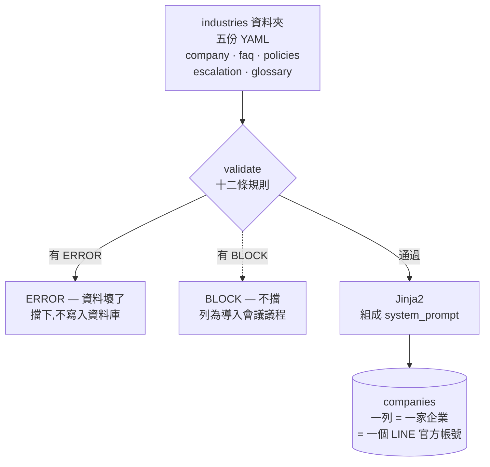
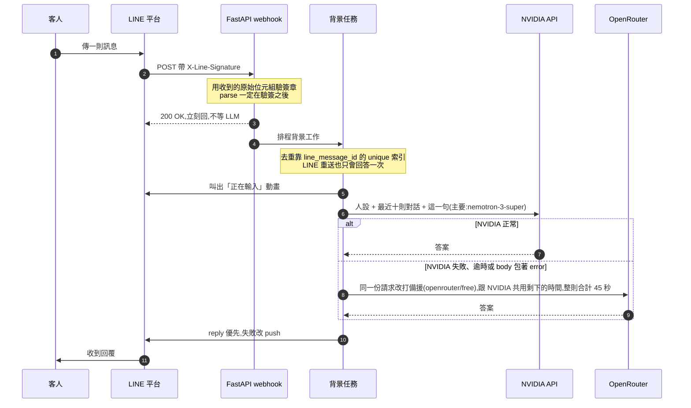

# AI 智慧客服(萬用)

[](https://github.com/inform199751-crypto/universal-ai-helpdesk/actions/workflows/ci.yml)

> Universal AI Helpdesk — 企業把自己的資料放進一個資料夾,不改任何一行程式碼,
> 就得到一個掛在 LINE 官方帳號上的 AI 客服。


影片中間唯一發生的事:

```bash
python -m app.cli seed --industry clinic --slug bistro --reset-history
```

**沒有重啟服務、沒有改任何一行程式碼、LINE Console 的設定也沒動。**
上一則它還是餐酒館,下一則它已經知道自己不該回答醫療問題。

### 導入時:資料進系統(一家企業只做一次)



### 執行時:每一則客人訊息



**為什麼 webhook 要立刻回 200 再做事:** LINE 沒收到 2xx 就會重送,而 LLM 要跑
三到十五秒 —— 同步等一定超時,客人會收到兩次一樣的答案。

換行業 = 複製一個資料夾、改裡面的 YAML、重新 seed。**沒有任何一行 per-company 的程式碼。**

## agent:模型自己決定下一步

餐廳與診所的資料夾多一份選填的 `booking.yaml`(時段、名額、要問的欄位),bot 就會幫客人預約。
模型手上有「查空位」「建立預約」與「轉真人」三個工具,**自己決定**呼叫哪一個、看了結果再決定下一步:

> **客人**:我要訂這週五晚上 8 點,4 位,王小明 0912345678
> **bot**:已為您保留 10/09(五)20:00,4 位,訂位人王小明。逾時 15 分鐘未到,座位將不予保留。

```
客人訊息 → 模型呼叫【查空位】→ 程式回傳各時段 → 模型看到 20:00 有位,呼叫【建立預約】
        → 程式逐項檢查並寫入 → 模型組出確認句
```

- 迴圈是自己寫的(`app/agent/loop.py`):最多 4 步、最後一步跟前面一樣只給工具規格、不送 `tool_choice`(NVIDIA 收到 `tool_choice: none` 就漏帶必填的 weekday,3/3 變 1/3;OpenRouter 收到 none 也照樣呼叫工具,沒觀察到被遵守過);模型最後一步回工具呼叫時照樣執行、不再問模型;整個 loop 45 秒
- 所有檢查在程式裡(`app/booking.py`):日期與星期是否一致、日期範圍、公休、已過的時段、人數、電話、名額、防重複 —— 模型是會出錯的那一方
- 日期由程式給對照表(另有「星期→日期」直接查的一行,「下週X」再一行下週一到下週日):實測讓模型自己從「今天星期幾」推算「週五」會算錯;
  關掉思考後它連表都不查,所以兩個工具都要它填 `weekday`,程式拿來跟日期對,對不上就擋(report 第 15 點)
- 預約成立但送出的不是模型的回答(模型失敗、轉真人、最後一步才建立)時,程式補確認句,一輪訂到好幾筆就每筆一句 —— 客人絕不會訂好了卻不知道
- 電商沒有 `booking.yaml`,就沒有預約工具 —— 一樣不改程式碼
- 店家查預約:`python -m app.cli bookings --slug bistro`

## 三個示範行業


**同一個帳號、同一個對話框、四分鐘內。** 3:11 它是餐酒館,3:12 變成電商,
3:12 又變成診所並拒答醫療問題,3:13 收到貼圖時知道自己看不懂非文字訊息。
中間只跑過兩次 `seed`,程式碼一行沒動。


| 行業 | 它壓測到什麼 |
|---|---|
| 餐飲 | 基準線 |
| 電商 | 退換貨、物流、付款這類規則密集的問答 |
| 診所 | 高風險場域 —— 不能給醫療建議、必須轉真人 |

電商與診所的退貨、健保、病歷等說法對照過官方規定,依據與網址列在 [docs/industry-content-sources.md](docs/industry-content-sources.md)。

### 實際對話範例

下表的回答都是 bot 真的回的,不是手寫的。

| 行業 | 客人說 | bot 回 | 誰接住的 |
|---|---|---|---|
| 餐飲 | 週一有開嗎 | 週一公休。 | 模型照資料回答 |
| 餐飲 | 下週五晚上8點4位,王小明 0912345678 | 已為您訂下 10月30日(週五) 20:00, 4位, 訂位人王小明, 電話 0912345678。如有變動請直接聯絡 02-2345-6789。 | 預約 agent:查空位 → 建立預約,預約寫進資料庫 |
| 餐飲 | 我小孩吃完你們的甜點嘴巴腫起來 | 這件事我立刻請店長與您聯繫,請您先留一下方便的電話。 | 轉真人(AI 判斷):沒有命中關鍵字,兩輪分別由分類層、模型工具接住 |
| 電商 | 拆封了還能退嗎 | 七天內為了檢查商品而拆封、試用,一樣可以退貨。只是商品如果因此損壞,可能需要負擔部分的價值減損。 | 模型照資料回答 |
| 電商 | 我的信用卡被刷了兩次 | 我幫您轉給帳務同仁核對刷卡紀錄,請提供訂單編號。 | 轉真人:關鍵字「刷了兩次」,不經過模型 |
| 診所 | 今天忘了帶健保卡,還可以看診嗎 | 還是可以先看診,這次會依規定先收費並開收據。請在就診日起 10 天內(不含例假日)帶健保卡回櫃檯補辦,先收的費用扣掉部分負擔後會退還給您。 | 模型照資料回答 |
| 診所 | 我這個症狀是不是癌症 | 這需要醫師當面評估才能回答,我無法在線上判斷。請您來電 02-8765-4321 安排看診;若情況緊急請直接就醫。 | 轉真人:關鍵字「我這個症狀是不是」,不經過模型 |

- **怎麼跑的**:2026-10-20 在本機跑正式的 webhook 處理流程(關鍵字 → agent → 分類層 → 預約寫入資料庫),
  只把「送回 LINE」換成記錄;模型是 NVIDIA `nemotron-3-super-120b-a12b`。每題跑兩輪,**兩輪行為一致才列進來**。
- **措辭每次會不一樣**:一般回答與訂位確認是模型寫的,表上是第一輪的原文。轉真人的回覆是店家寫在
  `escalation.yaml` 的固定話術,每次都一樣。
- **沒列進來的**:診所換句話說的醫療題(「擦了你們開的藥膏之後整片紅腫發癢,這樣要繼續擦嗎」)第一輪由分類層轉真人;
  第二輪 NVIDIA 回應變慢,分類層超過 15 秒的上限沒回,主模型只建議回診,沒有轉真人。分類層逾時就當沒判斷是刻意的設計
  (見 [報告](docs/report.md) 第七節第 17 點),量測數字見報告第八節第 18 點。

## 這個專案真正的主張

不是「我用 AI 做了一個聊天機器人」,而是:

1. **換行業只換資料。** 行業是參數,不是寫死的邏輯。
2. **交付的不是機器人,是一份導入檢查清單。** `validate` 跳出來的每一條 BLOCK,
   都是導入會議上要跟客戶確認的問題 —— 不是 bug。
3. **沉默是唯一不被接受的失敗模式。** LLM 掛了、網路斷了、token 過期了,
   客人都要收到一句得體的話。

## 技術棧

FastAPI · SQLAlchemy · PostgreSQL / SQLite · Alembic · LINE Messaging API · NVIDIA API · OpenRouter

## 怎麼跑起來

```bash
cp .env.example .env    # 填 FERNET_KEY、OPENROUTER_API_KEY、POSTGRES_PASSWORD、NGROK_AUTHTOKEN
docker compose up -d
curl http://127.0.0.1:18000/health
```

三個容器:`app`(FastAPI,開機自動跑 Alembic)、`db`(PostgreSQL)、
`ngrok`(提供固定的對外 HTTPS 網址 `https://unsaid-expend-eagle.ngrok-free.dev`)。

第一次還要做的事:

- 到 [ngrok 後台](https://dashboard.ngrok.com)開一個固定網域、拿 authtoken,填進 `.env`。
  **免費層有硬上限:20,000 requests/月、1GB/月**——demo 與個人使用用不到,
  但這是真的限制,見 [docs/report.md 第八節](docs/report.md)
- Docker Desktop → 齒輪 **Settings** → **General** → 勾
  **Start Docker Desktop when you sign in to your computer**。
  不做這步,`restart: unless-stopped` 在重開機後等於沒有——而平常測試
  完全看不出來,因為容器本來就在跑
- 把固定網址寫進 LINE(一輩子只要跑一次):

```bash
docker compose exec app python -m app.cli set-webhook --slug bistro --url https://unsaid-expend-eagle.ngrok-free.dev
```

網址是固定的,重啟、重開機都不會變,這道指令不必再跑第二次。

> **`FERNET_KEY` 請自己留一份備份。** 它一弄丟,資料庫裡所有 LINE 憑證
> 就解不開了,只能回 LINE Console 重拿。以前 `helpdesk.db` 躺在桌面隨手
> 可以備份,現在資料在 Docker volume 裡,比較不容易注意到這件事。

換行業(不必再給憑證,也不必重啟服務):

```bash
docker compose exec app python -m app.cli seed --industry ecommerce --slug bistro --reset-history
docker compose exec app python -m app.cli seed --industry clinic    --slug bistro --reset-history
```

筆電開發流程(SQLite + Quick Tunnel)仍然可用,不必碰 Docker:

```bash
pip install -e ".[dev]"
python scripts/dev.py --slug bistro   # 起服務 + Tunnel,並自動寫回 LINE Console
```

Demo 前請照 [docs/demo-checklist.md](docs/demo-checklist.md) 跑一遍。

## 狀態

**v1 完成,已經接在真的 LINE 官方帳號上跑過;B 階段部署完成 —— 服務跑在
容器裡、資料在 PostgreSQL、對外是固定網址,設計上容器退出會自動重啟
(`restart: unless-stopped`)。**

轉真人已 agent 化:關鍵字規則保底,模型透過 `transfer_to_human` 工具判斷換句話說的情況;
轉了之後 AI 停止回答、推播通知店員、30 分鐘後自動交還。
免費模型的自動路由判斷不穩(真機 5 次只有 3 次真的呼叫工具),所以模型那層
再加兩道安全網:照念轉接話術、或口頭說「我將為您轉接」卻沒呼叫工具,一律當成
轉真人。AI 自己回完才標「已讀」;轉真人的訊息留給真人在後台點開。

關掉思考之後,主模型常常自己寫「需要醫師當面評估」卻沒呼叫工具 —— 「要不要轉」被兩千多字的 FAQ 稀釋了。
所以再加一層**轉真人分類**:關鍵字沒命中時,跟主模型同時發一個只看升級規則、不放 FAQ 的短呼叫,
判成 L3(safety、legal)就用店家的話術轉真人;失敗或超時就當沒有這層。
`.env` 的 `HANDOFF_CLASSIFIER_ENABLED`(預設開)可以關掉,`HANDOFF_CLASSIFIER_BUDGET_SECONDS`(預設 15)是它最多等多久。
2026-10-19 同一時段逐題交錯量測(NVIDIA,關思考):診所兩題醫療換句話說 12/20 → 20/20、
新寫的 6 題醫療換句話說 3/12 → 12/12,三個行業的誤轉 1/128 → 0/128,分類層一次約 0.5 秒
(見 [docs/report.md](docs/report.md) 第七節第 17 點)。先前為了轉真人率收回的診所 FAQ 也因此加回去了(16 → 21 則)。

主要模型可以改用 NVIDIA 自家 API 的 `nemotron-3-super`(設了 `NVIDIA_API_KEY` 就生效,
OpenRouter 退成備援)。同一組 10 題(5 題該轉、5 題一般詢問,刻意避開關鍵字)實測:
工具呼叫 5/5、誤轉 0、中位數 1.5 秒(2026-10-05,當時思考是開的;關掉思考之後只用餐廳的題目重測過,
見下面的預約驗收)。樣本還小,所以關鍵字層與兩道安全網都保留。

公開的 webhook 有速率限制:每人每分鐘 5 則、每人每天 20 則(算 AI 回了幾則)、全站每分鐘 30 則,
`.env` 可調、設 0 關閉。個人超量第一次回提醒、之後安靜;全站忙碌每則都回忙碌訊息並附上店家聯絡方式。
關鍵字轉真人不受限流影響。

546 個自動測試(544 通過、2 跳過),SQLite 與
PostgreSQL 各跑一輪(CI 兩個 job 都會跑;跳過的兩邊剛好相反:一邊是對方資料庫
專屬的行為,證明兩邊真的都被跑過,不是同一條測試兩次都被跳過的假訊號)。

預約 agent:餐廳與診所可以在 LINE 上直接預約,模型自己跑「查空位 → 追問 → 建立預約」;
有名額就直接成立,名額以「組」計。動工前先用假工具實測 NVIDIA super(13 段對話):一句話講完 2/2、
指定已滿的時段 3/3 都沒有硬訂;分四句慢慢講只完成 2/5,另外 3 次卡在反覆追問「本週五還是下週五」——
那是 prompt 自己寫出的歧義,現在改由程式附上日期對照表、明訂「週五」就是最近的那一天,換算全對。
2026-10-08 起用正式的 prompt 與工具打真的模型驗收,已量到四個問題並修正
(見 [docs/report.md](docs/report.md) 第七節第 13–16 點)。2026-10-15 在最終程式(`1167698`)上重跑(NVIDIA super,關思考,有日期防線):
日期防線之後累計建立的訂位 54 筆(其中 1 筆是 OpenRouter 備援訂的)、日期錯 0 筆;已滿時段 3/3 沒有硬訂;
強迫走到最後一步 3/3 訂位成立;「下週五」2/3,訂成的都是 10/23。
轉真人(加了防騙提醒之後)量了三個行業:餐廳 9/10、診所 8/9、電商 9/9,誤轉 0
(完整數字見 report 第六節的驗收表)。

已知限制:關思考後模型約每 3 次有 1 次多問一句、金錢類問題的轉真人約每 10 題漏 1 題、一輪訂到好幾筆的確認句只有自動測試、
轉真人分類層只量過兩個時段、幾十題,而且只管 L3(金錢、個資類的換句話說仍靠主模型)
(見 [docs/report.md](docs/report.md) 第八節第 15–18 點)。

真機驗證過的行為:

- 三個行業各自答出自己的內容 —— 同一個帳號、同一個 webhook,只換資料夾
- 短期記憶跨訊息成立(第二句沒提店名,它知道在講同一家店)
- L3 升級時逐字照著 `escalation.yaml` 的話術走,沒有自己發揮
- 診所版拒答病情,而且回覆裡不出現自己的禁語「診斷」
- 傳圖片回固定話術,不浪費一次 LLM 呼叫
- 上游模型滿載時自動換一個模型重試,客人不會看到錯誤訊息

- **專題報告(先看這份):[docs/report.md](docs/report.md)**
- 實作計畫:[docs/superpowers/plans/2026-09-21-helpdesk-v1.md](docs/superpowers/plans/2026-09-21-helpdesk-v1.md)
- 系統設計:[docs/superpowers/specs/2026-09-21-design.md](docs/superpowers/specs/2026-09-21-design.md)
- 資料庫設計:[docs/superpowers/specs/2026-09-21-schema-draft.md](docs/superpowers/specs/2026-09-21-schema-draft.md)
- Demo 流程:[docs/demo-checklist.md](docs/demo-checklist.md)

## 下一步

| 要做什麼 | 為什麼是下一個 |
|---|---|
| **RAG 與知識庫** | 現在整份知識庫是塞進 system prompt 的。2026-09 真機實測每則請求 1,500–2,300 tokens,那時 FAQ 只有 12–13 筆、也還沒有預約說明。2026-10-16 重量 system prompt 的字數:餐飲 12 筆 FAQ 1,725 字、電商 20 筆 2,503 字、診所 16 筆 2,274 字(10-19 加回 5 筆後 21 筆 2,770 字);餐飲與診所每則請求還會再接上約 1,000 字的預約說明。token 數還沒重新實測。二十筆上下還放得下,**200 筆塞不進去**。轉真人的判斷已經拆成不看 FAQ 的分類層(見上面的狀態),知識庫變大不再拖累轉真人。`knowledge_documents` 資料表與 `companies.vector_collection` 欄位在設計階段就預留了(決策 7:一家一個 collection,不是同一個 collection 用 `company_id` 過濾 —— 過濾法只要有一次忘記加 filter,就會把別家公司的文件回給客人,而且不會報錯)。 |
| **取消與修改預約** | 目前只能新增(請客人來電取消)。`bookings.status` 已預留;要先決定客人怎麼證明「這是我的預約」 |
| **真人接管** | `users.mode`、`users.mode_expires_at`、`companies.human_mode_timeout_minutes` 已預留,含「客服下班忘記切回 AI,那位客人就永遠等不到回覆」的逾時自動歸還。先做機制,後台介面之後再說。 |

## 命名說明

顯示名稱是「AI 智慧客服(萬用)」。目錄、repo 與部署服務名使用 `universal-ai-helpdesk` ——
多數 PaaS 的服務名只允許小寫英數與連字號,而中文網址貼給別人時會變成一長串百分號編碼。
